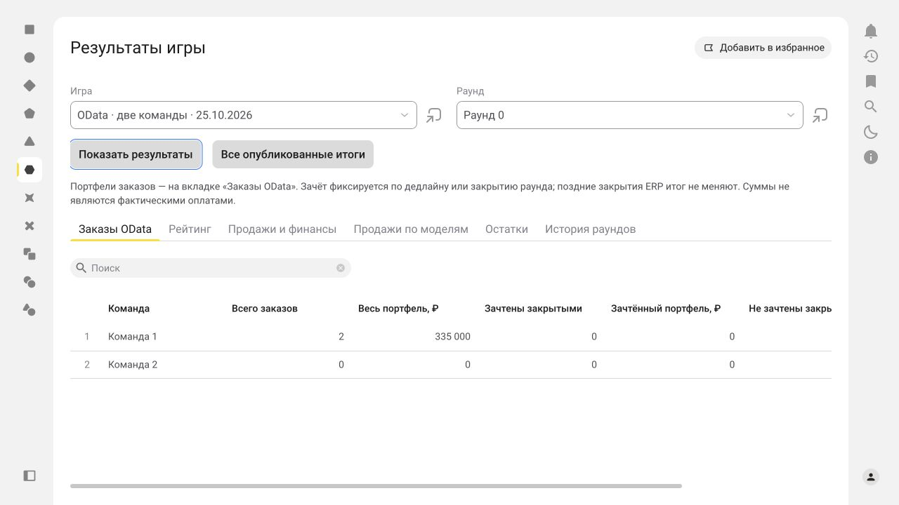
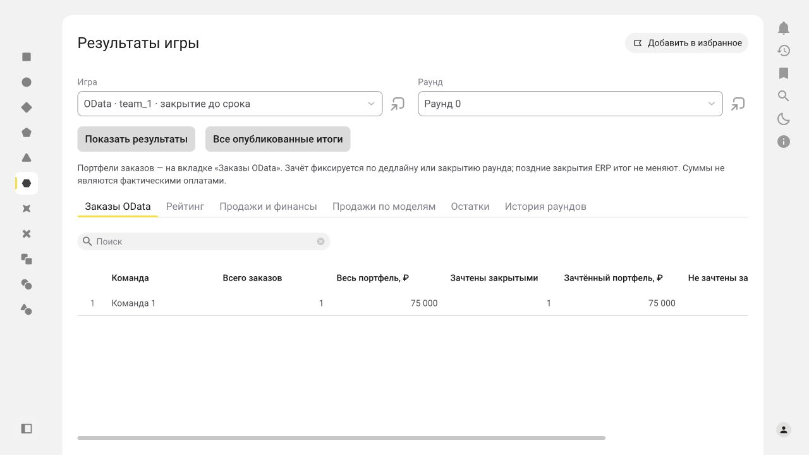
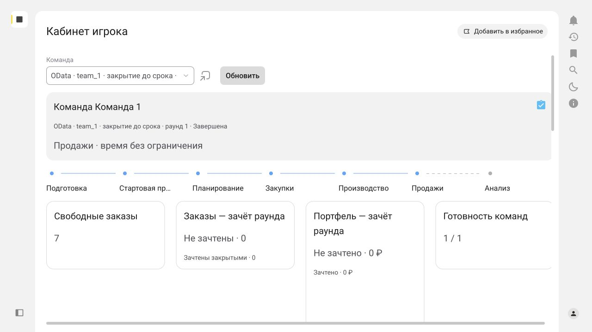

# Проверка цикла OData, 25–26 октября 2026

Прогон выполнен в [game-dev](https://app-312909758.1cmycloud.com/applications/game-dev).
После уточнения пользователя игровые действия проверялись только под `team_1`.
Пароли и сессии авторизации в этом протоколе и Git отсутствуют.
Окончательная публикация **1.0-83**, исходники приложения — коммит `1ed588f`.

## Окружение и состав

- ERP команды 1: приложение `1550923`, организация `ДвижжОК ООО`.
- ERP команды 2: приложение `1550924`; исходная настройка выполнена до сокращения
  объёма проверки. Вход игрока `team_2` не прошёл; по указанию пользователя его
  игровой цикл не выполнялся. Успешную маршрутизацию от двух реальных игроков
  этот прогон не доказывает.
- Обе исходные базы настроены стандартным OData без установки расширения:
  по 72 шага подготовки, с проверкой начальных остатков и цен. Существующий
  профиль отдельно помечает ручные настройки планирования, калькуляции и
  регламентированного учёта как незавершённые. Полный производственный режим
  и финансовый рейтинг не входили в этот тест публикации заказов.
- Приложение запускалось кнопкой «Запустить только рынок OData»; команды
  этапов и итоговые снимки HTTP-расширения не использовались.
- Отгрузка и оплата для проверки закрытия оформлялись вручную в учебном ERP.
  Автоматизация игры публиковала только заказы клиента и читала их состояние.

## Сохранённые результаты

| Игра и раунд | Заказы team_1 | Портфель | Зачтены закрытыми | Зачтённая сумма |
|---|---:|---:|---:|---:|
| OData · две команды · 25.10.2026, раунд 0 | 2 | 335 000 ₽ | 0 | 0 ₽ |
| OData · две команды · 25.10.2026, раунд 1 | 1 | 75 000 ₽ | 0 | 0 ₽ |
| OData · team_1 · закрытие до срока, раунд 0 | 1 | 75 000 ₽ | 1 | 75 000 ₽ |
| OData · team_1 · закрытие до срока, раунд 1 | 0 | 0 ₽ | 0 | 0 ₽ |

Обе игры завершены. Во втором прогоне второй технический участник отключён
до запуска: пульт подтверждал состав **1 команда**. Новая подготовка исходных
остатков поверх уже созданных документов не выполнялась.

Первая игра: [карточка](https://app-312909758.1cmycloud.com/applications/game-dev?navLink=data/j4jj33vphrfvthc7brtumjk73i/agqxhjetpz7x5eze2e3c233jym).
Положительная проверка: [карточка](https://app-312909758.1cmycloud.com/applications/game-dev?navLink=data/j4jj33vphrfvthc7brtumjk73i/agqxiuanar63ll5neh2ec34s2i).
Для истории выберите игру и раунд на странице «Результаты» → «Заказы OData».
Кабинет показывает текущий, а после завершения — последний раунд.

### Закрытие после срока

ERP-заказ `0000-000001`, GUID `01a173af-6687-731c-8334-10f8f028d5c4`,
CargoMax, 2 шт., 260 000 ₽. Заказ полностью отгружен и оплачен, проведён со
статусом `Закрыт` после дедлайна раунда 0. В кабинете отображались отдельно
живой статус «Закрыт» и пояснение «Итог раунда зафиксирован: не зачтён закрытым».
В сохранённом отчёте раунда 0 зачёт остался **0 ₽**.

### Закрытие до срока

Из кабинета `team_1` получен рыночный заказ №4, CityRide, 1 шт., 75 000 ₽.
ERP-заказ `0000-000004`, GUID `01a176c7-1c24-7f2e-aec7-9718969d632e`,
автоматически создан и проведён в базе `1550923` без ручного исправления.

В ERP оформлены по заказу и проведены:

- реализация `0000-000002` от 15.10.2026 13:00, GUID
  `2b0e11f9-d102-11f1-b003-7cc2553c1b47`;
- поступление безналичных ДС `0000-000002` от 15.10.2026 14:00, GUID
  `4c39da4f-d102-11f1-b003-7cc2553c1b47`, 75 000 ₽.

Помощник закрытия ERP подтвердил отгрузку 100% и оплату 100%. После закрытия
независимое OData-чтение подтвердило `Posted=true`, `Статус=Закрыт`, количество
1, `Отменено=false`. Фоновая сверка без ручного обновления зачла **1 заказ,
75 000 ₽** при оставшихся 15 минутах. Команда досрочно завершила этап;
после перехода ведущего итог раунда 0 остался тем же. Последний минутный раунд
завершился по таймеру, затем ведущий завершил игру.

### Завершённый кабинет

На окончательной версии выполнен повторный вход `team_1` и перезагрузка
кабинета. Доступ к своей завершённой игре сохранён; показаны последний раунд
1, готовность **1 / 1** и сообщение «Игра завершена. Итог последнего раунда
зафиксирован». После выбора свободной карточки кнопки получения заказа и
завершения этапа имеют `aria-disabled=true`. Пульт ведущего также показывает
завершение и готовность 1 из 1. Новых ERP-документов эта проверка не создала.

## Исправления

| Коммит | Изменение |
|---|---|
| `4a7d638` | Сверка статусов ERP и фиксация зачёта к сроку раунда; единая сводка портфелей кабинета |
| `e42f938` | Проверка исходного XBSL-метода фиксации на границе дедлайна |
| `74fe9b5` | Обязательная дата отгрузки и согласование заказа в исходной ERP |
| `7c246ed` | Допустимая длина ключа фонового задания; корректный PATCH и восстановление своего черновика без дублей |
| `81af17c`, `e286249` | Вкладка итогов OData, доступ к завершённому кабинету, защита зафиксированного зачёта и зависимость аналитики |
| `30c127c` | Завершённая игра не требует нового заявления готовности после смены токена |
| `1ed588f` | Завершённый кабинет показывает итоговую готовность и сообщение о завершении вместо приглашения подтвердить этап |

Создаваемый заказ получает статус ERP `КОбеспечению` («К выполнению»),
позволяющий оформить обычную реализацию в исходной конфигурации.

Без расширения ERP точное время изменения статуса между опросами неизвестно.
Зачёт основан на **подтверждении сервером до дедлайна**, а не только на дате
документа ERP. Частота проверки при открытом кабинете — 5 секунд. Поздний ответ
начавшегося ранее запроса также не изменяет зафиксированный результат.

## Воспроизводимость

`python3 scripts/test_market_odata.py --runtime <путь-к-script_u_10.0.2_1>`:
PASS, 165 запросов к локальному OData-стенду, 4 проведённых заказа. Проверяется
исходный XBSL: создание/повтор, владение и аренда, изоляция фаз, закрытие и
повторное открытие, дедлайн, поздний ответ, ошибки, чужие/удалённые/непроведённые
документы, фоновый обмен и доступ назначенного игрока к завершённой игре.

Метаданные: 132 файла, 0 ошибок, 48 предупреждений покрытия валидатора.
`git diff --check` пройден.

Обычные Playwright specs для повторного **чтения сохранённых игр** находятся
в [e2e](../e2e/README.md). `npm test -- --list` обнаруживает 3 проверки.
Автономный UI-запуск этих specs не выдаётся за выполненный: живая проверка
выполнена через браузер Codex, а для повторного Playwright-запуска требуется
локальная авторизованная сессия. Снимки и ожидаемые значения получены из
реального приложения, а не из моков.
